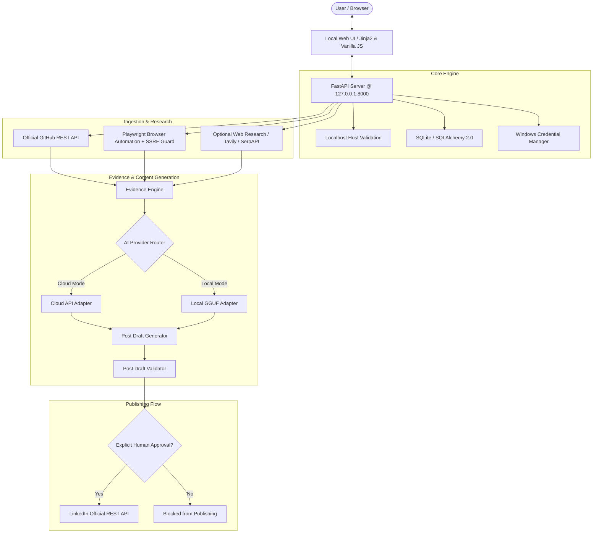

# ⚡ GitHub LinkedIn AI Publisher (Build2Buzz)

A modular, local-first Windows application that reads a project's GitHub README, inspects its working demo using controlled browser automation, enriches facts with optional web research, and drafts high-impact LinkedIn posts using a configurable AI provider—publishing **only after explicit human approval** via LinkedIn's official REST API.

---

## 🌟 Key Features

- **Local-First & Secure:** Binds strictly to `127.0.0.1:8000`. Sensitive API keys and OAuth tokens are stored exclusively in the **Windows Credential Manager** via `keyring`—never in SQLite, config files, browser local storage, or logs.
- **GitHub Ingestion:** Fetches README and repository metadata directly from the official GitHub REST API (public repos unauthenticated; private repos authenticated via PAT).
- **Working Demo Inspection:** Uses Playwright to navigate to demo URLs, extracting page titles, descriptions, visible text, and full screenshots with robust SSRF defenses (blocking loopback, private IP ranges, and unauthorized ports).
- **Mutually Exclusive AI Providers:** Choose between **Cloud AI API** (OpenAI, Gemini, Anthropic, or OpenAI-compatible) and **Local GGUF LLM** (on-device inference via `llama-cpp-python`). Zero silent fallbacks between providers.
- **Factuality & Claim Validation:** Automatically isolates documented facts from demo observations. Enforces length constraints, scans for accidental secret leaks, and detects duplicate published posts.
- **Human-in-the-Loop Post Editor:** Interactive dashboard allows real-time editing, character counting, link verification, approval, and official one-click LinkedIn publication.
- **Windows Batch Automation:** Easy startup and testing via `setup.bat`, `run.bat`, and `test.bat`.

---

## 🏛️ Architecture Overview



---

## 📋 Prerequisites

1. **Windows 10/11 (64-bit)**
2. **Python 3.11** (recommended; Python 3.11.9 verified)
3. **Google Chrome / Chromium** (installed automatically via Playwright in `setup.bat`)
4. *(Optional)* **LinkedIn Developer App** (for publishing posts directly to personal LinkedIn profile)
5. *(Optional)* **AI API Key** (e.g. OpenAI or Gemini) or a downloaded `.gguf` model for local inference.

---

## 🚀 Quick Start (Windows CMD)

### 1. Setup the Environment
Open Windows Command Prompt (CMD), navigate to the project directory, and run:
```cmd
setup.bat
```
This script will:
- Verify Python 3.11
- Create a virtual environment (`.venv`)
- Install all dependencies from `requirements.txt`
- Download the Playwright Chromium browser binary
- Initialize the local database directory (`data/`)

### 2. Launch the Application
Start the server and automatically launch the dashboard in your default browser:
```cmd
run.bat
```
The application will be accessible at:
👉 **[http://127.0.0.1:8000](http://127.0.0.1:8000)**

### 3. Run the Automated Test Suite
To verify the entire test suite (42 unit, integration, and security tests):
```cmd
test.bat
```

---

## ⚙️ Configuration & Credentials

All sensitive credentials are stored directly in **Windows Credential Manager** under the service name `GitHubLinkedInAIPublisher`.

| Credential | Key Name | Purpose | Where to Enter |
|---|---|---|---|
| AI API Key | `ai_api_key` | OpenAI, Gemini, or custom LLM API key | UI -> AI Settings |
| GitHub PAT | `github_pat` | Increases rate limit to 5,000 req/hr; accesses private repos | UI -> Integrations |
| LinkedIn Client Secret | `linkedin_client_secret` | OAuth 2.0 authorization code exchange | UI -> Integrations |
| LinkedIn Access Token | `linkedin_access_token` | Stored automatically during OAuth callback | UI -> Integrations |
| Web Search API Key | `search_api_key` | Tavily or SerpAPI key for external research | UI -> Integrations |

Non-secret preferences and database records are stored locally in `data/publisher.db`.

---

## 🔒 Security Model

- **Localhost-Only Enforcement:** FastAPI application verifies incoming `Host` headers and rejects any requests outside `127.0.0.1` and `localhost`.
- **SSRF Defense:** All user-provided demo URLs and external research URLs undergo DNS resolution checks, rejecting private addresses (`10.0.0.0/8`, `172.16.0.0/12`, `192.168.0.0/16`), loopback (`127.0.0.0/8`), link-local (`169.254.0.0/16`), and non-standard dangerous ports.
- **Secret Redaction:** Built-in logging formatters and draft validators automatically mask and detect API keys (`sk-...`, `ghp_...`, Bearer tokens) to prevent accidental disclosure.
- **Explicit Human Approval Invariant:** The publishing service strictly enforces that drafts cannot transition to `PUBLISHING` or reach the LinkedIn API unless they are in the `APPROVED` state. Editing an approved draft immediately resets its status back to `NEEDS_REVIEW`.

---

## 📚 Detailed Documentation

- [docs/ARCHITECTURE.md](docs/ARCHITECTURE.md): Deep architectural specification and data flow.
- [docs/SECURITY.md](docs/SECURITY.md): Threat model, SSRF safeguards, and credential isolation.
- [docs/API.md](docs/API.md): Complete OpenAPI REST endpoints and schemas.
- [docs/DEVELOPMENT.md](docs/DEVELOPMENT.md): Developer guide, test suite explanation, and extensibility.
- [docs/LEARNING_GUIDE.md](docs/LEARNING_GUIDE.md): Beginner-friendly code walkthrough and debugging exercises.

---

## 🛠️ Troubleshooting

- **`Python 3.11 not found`:** Install Python 3.11 from python.org and check "Add Python to PATH" during installation.
- **`Playwright Chromium download failed`:** Run `.venv\Scripts\playwright.exe install chromium` manually in CMD.
- **`LinkedIn publishing error: 403 Forbidden`:** Ensure your LinkedIn Developer App has the `Share on LinkedIn` (`w_member_social`) product enabled under the "Products" tab in the LinkedIn Developer Portal.
- **`Port 8000 already in use`:** Change the port in `.env` or run `netstat -ano | findstr :8000` to find the process ID.
