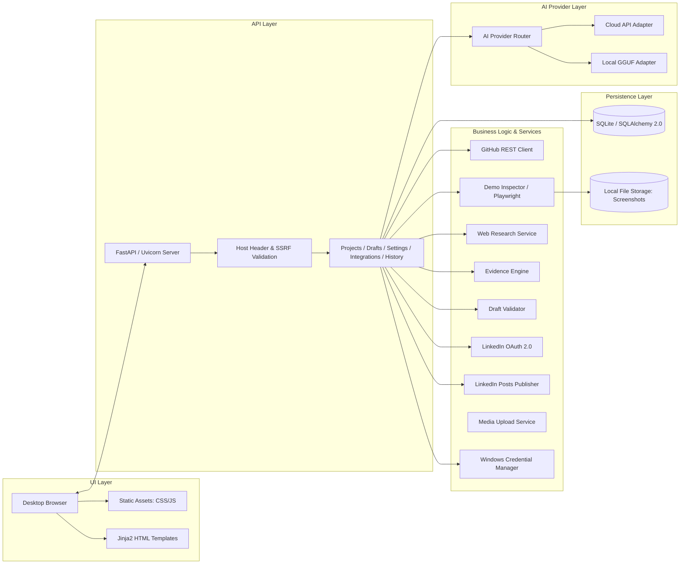
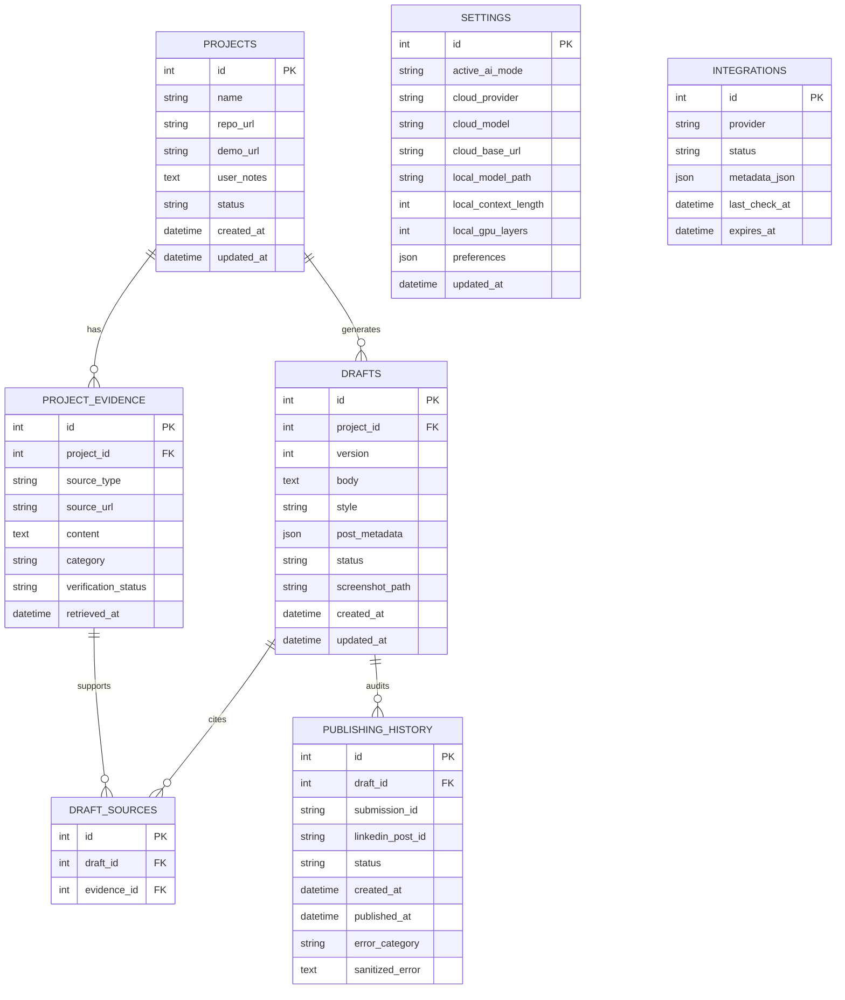
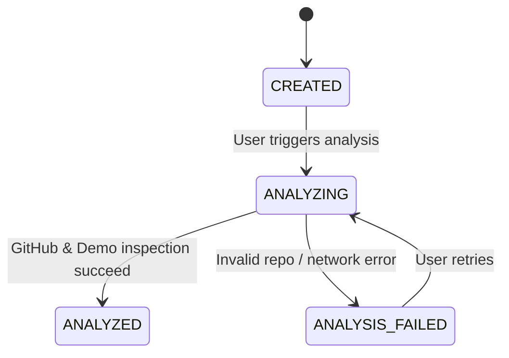
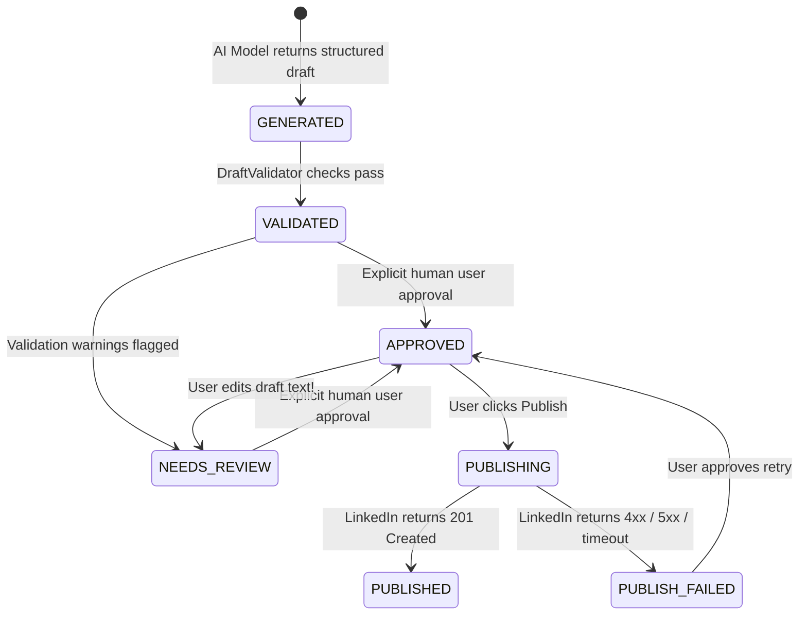

# 🏗️ Architecture Specification: GitHub LinkedIn AI Publisher

## 1. Architectural Philosophy & Principles

GitHub LinkedIn AI Publisher is structured as a **modular monolith** running locally on the user's Windows machine.

Key architectural tenets:
1. **Local-First & Offline-Capable:** Core data, draft history, models, and evidence stay on the local machine.
2. **Separation of Concerns:** Network integrations (GitHub, Playwright, LinkedIn, Web Search) are completely decoupled from persistence and business rules.
3. **Mutual Exclusivity:** The AI system enforces strictly one active inference provider at a time with zero silent fallback.
4. **Factual Grounding:** Prompts operate on structured, categorized evidence packages to prevent hallucination.
5. **Human-in-the-Loop:** Automated publishing is mathematically and structurally blocked without an explicit transition to `APPROVED`.

---

## 2. Component Diagram

---

## 3. Module Responsibilities

| Module | Location | Responsibility |
|---|---|---|
| **Core Config & Security** | `src/publisher/core/` | Pydantic settings schema, localhost constraint, logging with regex secret masking, and SSRF URL validator. |
| **Database & Persistence** | `src/publisher/db/` | SQLAlchemy 2.0 declarative models, connection sessionmaker, and CRUD repository pattern enforcing state transitions. |
| **GitHub Integration** | `src/publisher/services/github_service.py` | Official GitHub REST API client for metadata retrieval and Base64 README decoding. |
| **Demo Inspector** | `src/publisher/services/demo_inspector.py` | Headless Playwright Chromium automation with timeout safeguards and screenshot capture. |
| **Evidence Engine** | `src/publisher/services/evidence_engine.py` | Aggregates and categorizes facts into documented, observed, user-supplied, and external units. |
| **AI Provider Router** | `src/publisher/services/ai/` | Abstract provider interface, Cloud API adapter, Local GGUF adapter, and exclusive mode router. |
| **Draft Validator** | `src/publisher/services/validator.py` | Validates post length, links, secret leakage, and checks for previously published duplicate content. |
| **Credential Manager** | `src/publisher/services/credential_manager.py` | OS-level secret storage using `keyring` (Windows Credential Manager). |
| **LinkedIn Integration** | `src/publisher/services/linkedin_service.py` | OAuth 2.0 with PKCE/state verification, user profile extraction, and REST Posts publishing. |
| **Media Service** | `src/publisher/services/media_service.py` | Image validation and official LinkedIn 2-step media upload protocol. |

---

## 4. Database Schema (Entity Relationship Diagram)

---

## 5. State Machine Invariants

### Project State Machine

### Draft State Machine

> **Crucial Rule:** Any modification made to an `APPROVED` draft immediately transitions the draft back to `NEEDS_REVIEW`. Publishing cannot occur without re-approval.
